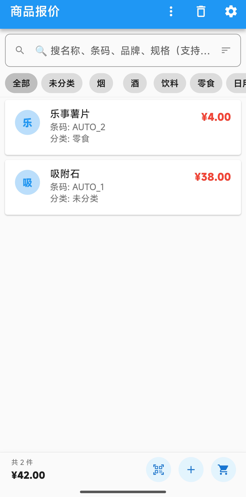
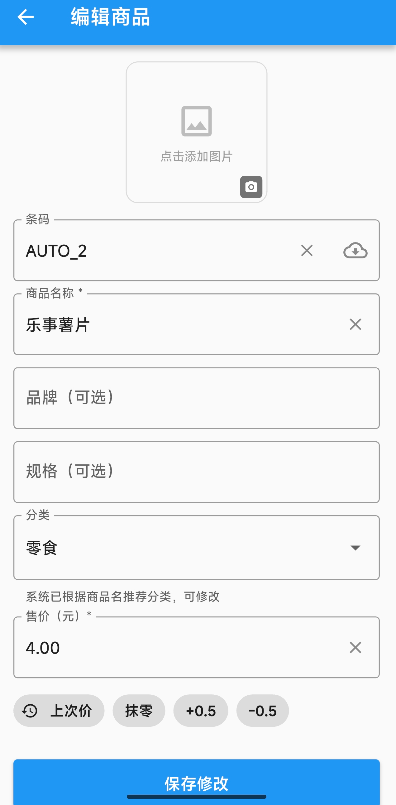
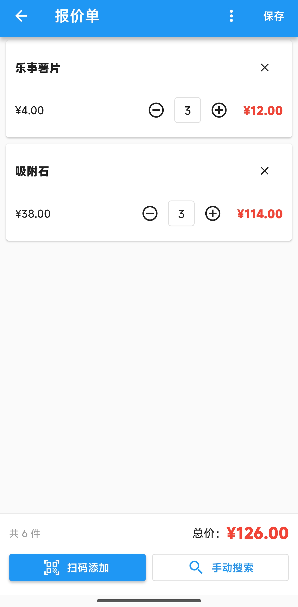
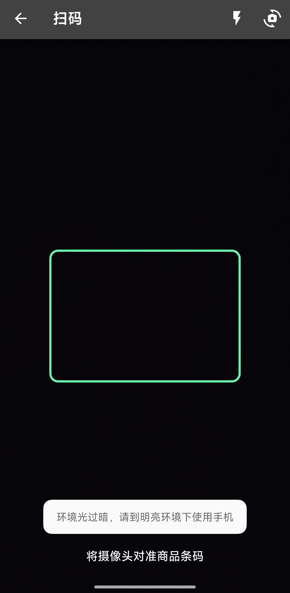
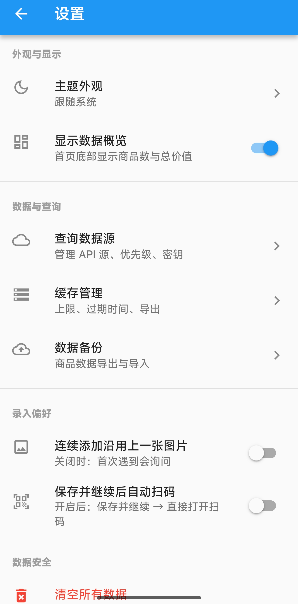
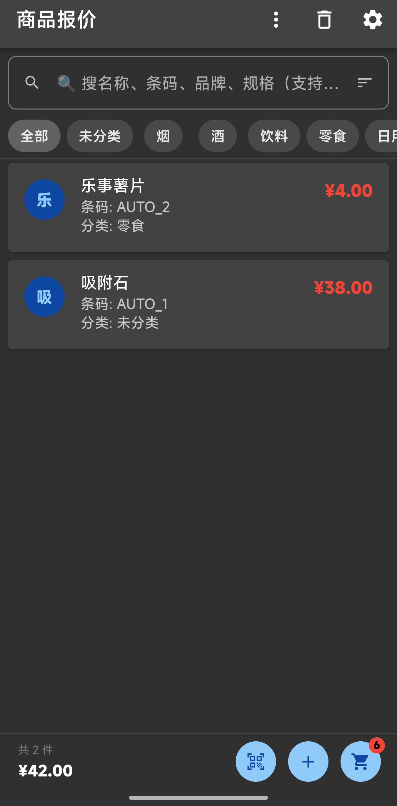

# 商品报价

> 纯本地商品管理 + 报价单工具。扫码录入、多源查询、零费用、不上传服务器。

一个轻量手机端工具：扫码/手动录入商品 → 自动查询基础信息 → 自定义售价 → 连续扫码累积报价单 → 一键导出 Excel。

所有数据存储在手机本地（SQLite），无云服务、无账号、无追踪。

## 截图

| 首页 | 编辑 | 报价单 |
| :---: | :---: | :---: |
|  |  |  |

| 扫码 | 设置 | 深色模式 |
| :---: | :---: | :---: |
|  |  |  |

## 功能

- **录入**：扫码 / 手动输条码（可留空，自动分配 `AUTO_N` 序号）
- **查询**：多源自动查询（Open Food Facts 免费兜底 + 可自定义 API）
- **商品管理**：分类筛选、6 种排序、模糊搜索、回收站、缩略图
- **报价单**：连续扫码累积、草稿自动保存、Excel 导出
- **数据**：商品 Excel 导出、JSON 备份导入导出（换机不丢）
- **个性化**：主题外观（跟随系统 / 浅色 / 深色）
- **合规**：免责声明、权限说明、API 隐私掩码

## 核心特点

- **纯本地** — 数据存 SQLite，无云服务、无账号、无追踪
- **零费用** — 默认使用免费数据源，无需注册
- **可自定义** — 支持接入任意 REST API 作为数据源
- **极简** — 不做进销存、不做财务、不做打印，只做"扫码查价 + 报价单"

## 安装

从 [Releases](../../releases) 下载最新 APK：

| 版本 | 大小 | 适用设备 |
| :--- | :--- | :--- |
| `app-arm64-v8a-release.apk` | ~36 MB | **推荐**，2018 年后的手机 |
| `app-release.apk` | ~72 MB | 全架构，兼容老旧设备 |

> 首次启动会显示用户协议与免责声明，同意后进入。

## 构建

需要 Flutter 3.22+ / Java 17 / Android SDK 34+。

```bash
flutter pub get
flutter build apk --release --target-platform android-arm64
```

**依赖说明**：本项目使用 `share_plus: 7.2.2`（10.x 与当前 Kotlin Gradle Plugin 存在冲突），如需升级请自行测试。

## 技术栈

Flutter 3.x · Provider · sqflite · mobile_scanner · excel · share_plus · image_picker · file_picker

## 项目状态

个人自用工具，**随缘维护**。

- Issue 不一定回复
- Pull Request 欢迎，但不保证 merge
- 欢迎 Fork 后自行改造

## 许可

[MIT](LICENSE)